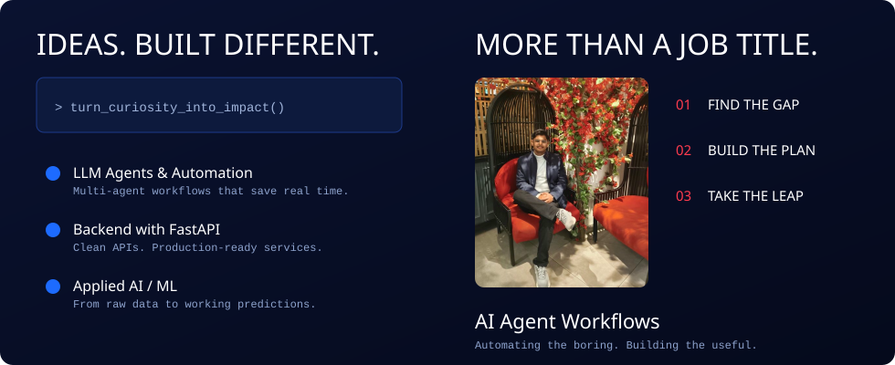
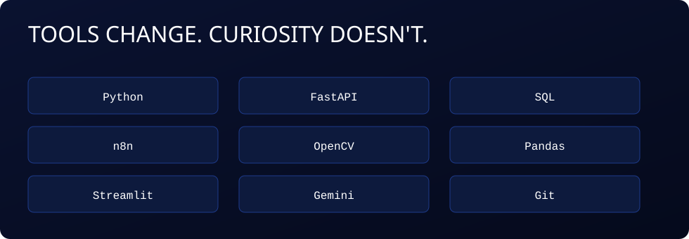
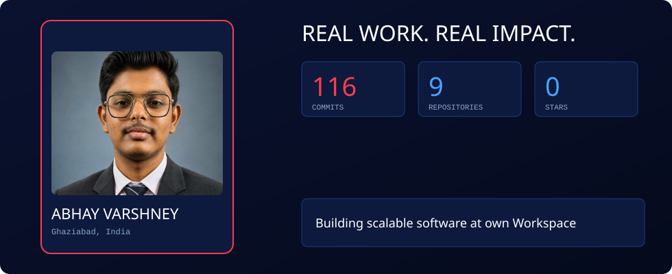
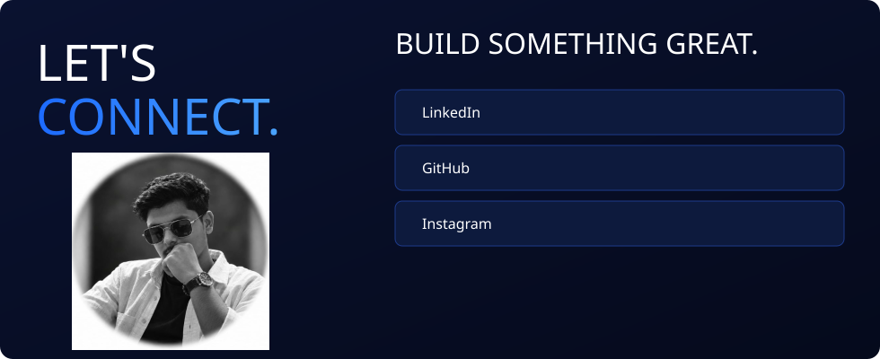

### Things I've built
| Project | What it does | Focus |
|---|---|---|
| Email Acknowledgement Automation | n8n + Gemini workflow that reads unread Gmail and auto-sends personalised replies | Automation + AI |
| Air Canvas Text Detection | Webcam hand-gesture app that turns air-written strokes into digital text | Computer Vision |
| Heart Failure Prediction | ML app (Random Forest, 89% accuracy) that predicts heart-failure risk in real time | Machine Learning |

[LinkedIn](https://linkedin.com/in/your-id) · [GitHub](https://github.com/Abhay-Varshney) · [Instagram](https://www.instagram.com/abhayvarshney24?vrfl=eDI3bm44eXUxbW44)

Curious by default. Building with intent.

